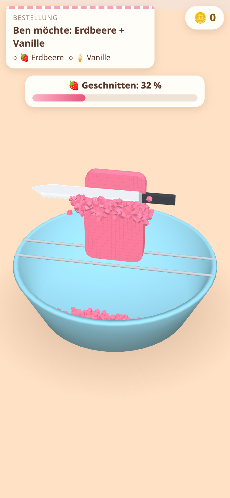

# 🧼 Seifen-Schneiden

Ein entspannendes Handy-Spiel im Browser: Seifen aus dem Regal nehmen, in feine Würfel schneiden
(wie bei „Seifenschneidespaß“), im Ofen zusammenschmelzen und die fertige marmorierte Seife verkaufen.

**Direkt spielen:** https://saschahoffmannsh-gif.github.io/seifen-schneiden/
(mit FPS-Anzeige: https://saschahoffmannsh-gif.github.io/seifen-schneiden/?fps=1)



## So wird gespielt

1. **Bestellung lesen** – unter der Schale steht, was die Kundschaft möchte, z. B. „Anna möchte: Erdbeere + Vanille“.
2. **Seife aus dem Regal nehmen** – auf dem mittleren Wandbrett stehen die Seifen fürs Rezept; antippen, dann fliegt sie über die Schale (die nächste gewünschte hüpft leicht).
3. **Schneiden** – die Seife steht aufrecht in einer Halterung über der Schale und hat genau eine Farbe.
   Sie besteht aus 2880 feinen Würfeln (15 × 24 × 8), aufgeteilt in 4 Scheiben. Den Finger einfach **hin und her (links ↔ rechts)** wischen. Das Messer sägt
   sich wie beim Brotschneiden durch die **vorderste Scheibe** von oben nach unten. Die Seife
   besteht aus kleinen Würfeln: Während das Messer tiefer geht, lösen sich die Würfel dieser
   Scheibe von oben nach unten und purzeln in die Schale. Unten angekommen fährt das Messer
   wieder hoch und schneidet die nächste Scheibe dahinter – Scheibe für Scheibe nach hinten.
   Oben zeigt „Geschnitten: … %“ mit Balken live, wie viel von der aktuellen Seife schon geschnitten ist.
4. **Zweite Seife** – nächste Seife im Regal antippen und in dieselbe Schale schneiden.
5. **🔥 In den Ofen** – die Würfel schmelzen zusammen (Fortschrittsbalken).
6. **✨ Aus der Form nehmen** – die fertige Seife ist marmoriert, die Farben und Anteile kommen
   aus den Würfeln, die du hineingeschnitten hast.
7. **🪙 Verkaufen** – die Schale verschwindet, die Seife legt sich auf den Tisch.
8. **Verpacken** – ein Päckchen im Regal antippen: ein Fenster mit allen Päckchen-Sorten geht auf (waagerecht scrollbar, nur „Kraftpapier“ ist freigeschaltet, die anderen haben ein Schloss). Gewähltes Päckchen fliegt auf den Tisch, Deckel geht ab; dann die Seife antippen (fliegt hinein, Deckel drauf).
9. **Verschicken** – das Päckchen zur Seite wischen: Geld wird gutgeschrieben (passt die Seife zur Bestellung, gibt es mehr Münzen), dann kommt die nächste Bestellung.

Funktioniert mit Touch (Handy, Hochformat) und mit der Maus.

## Lokal starten

Voraussetzung: [Node.js](https://nodejs.org) 18 oder neuer.

```bash
npm install
npm run dev        # Entwicklungsserver, auch im WLAN erreichbar (fürs Handy)
npm run build      # statische Version in dist/
npm run preview    # gebaute Version ansehen
```

Bei jedem Push auf `main` baut eine GitHub Action das Spiel und veröffentlicht es auf GitHub Pages.

## Aufbau des Codes

| Datei | Aufgabe |
| --- | --- |
| `src/main.js` | Startet alles, Hauptschleife (Delta-Time + fester Physik-Zeitschritt), FPS-Anzeige |
| `src/game.js` | Spielablauf: Regal → Schneiden → Ofen → Herausnehmen → Verpacken → Verschicken (Wischen), Messer-Steuerung |
| `src/soapBlock.js` | Intakter Seifenblock aus Voxeln (ein `InstancedMesh`) |
| `src/looseCubes.js` | Lose Würfel: Pool, eigene Mini-Physik, Höhenfeld zum Stapeln |
| `src/soaps.js` | Seifensorten, Farben und Innenmuster |
| `src/scene.js` | Renderer, Kamera, Licht, Holztisch, Metallschale, Fake-Schatten |
| `src/setting/wall.js` | Wand direkt hinter dem Tisch mit Holz-Ablagen und Deko (echte 3D-Geometrie, InstancedMesh) |
| `src/knife.js` | Gezacktes Messer |
| `src/marble.js` | Marmor-Textur für die fertige Seife |
| `src/confetti.js` | Konfetti-Partikel |
| `src/input.js` | Touch-/Maus-Eingabe |
| `src/packages.js` | Päckchen aus Kraftpapier (InstancedMesh): Regal, Tisch, Deckel, Schatten |
| `src/decor.js` | Päckchen-Sorten und Verpackungs-Deko (`unlocked`, Preis, Bonus; Kauf-Logik folgt später) |
| `src/shelfSoaps.js` | Rezept-Seifen auf dem mittleren Wandbrett (InstancedMesh), Antippen per Raycast, Flug zur Schale |
| `src/ui.js` | Bestell-Zettel unter der Schale, Münzen, Knöpfe, „So satisfying!“-Texte |
| `src/audio.js` | Generierte Geräusche (WebAudio) und Vibration |
| `src/config.js` | Alle Zahlen zum Feintuning an einer Stelle |

## Technik: warum es nicht ruckelt

- **Instancing:** Alle losen Würfel (bis zu 10 000) sind *ein* `InstancedMesh` = ein Draw Call.
  Der intakte Block ist ebenfalls ein `InstancedMesh`. Insgesamt ca. 10 Draw Calls. Die runde Seifenform entsteht im Vertex-Shader (Würfel-Ecken werden auf ein abgerundetes Seifenstück projiziert), nicht durch zusätzliche Objekte.
- **Nichts wird zur Laufzeit erzeugt:** Pool fest reserviert, geschnittene Würfel werden nur
  versteckt bzw. aus dem Pool aktiviert. Ist der Pool voll, wird der älteste Würfel recycelt.
- **Eigene, billige Physik statt Physik-Engine:** Schwerkraft, Abprallen an Block, Schalenwand
  und Boden. Gestapelt wird über ein Höhenfeld (keine Würfel-gegen-Würfel-Kollision).
  Liegende Würfel werden **eingefroren** und gar nicht mehr berechnet.
- **Fester Zeitschritt** (120 Hz) für die Physik, Animationen über Delta-Time (begrenzt auf 50 ms),
  dadurch auf 60- und 120-Hz-Displays gleich schnell und ohne Sprünge.
- **Kein Speicher-Müll im Frame:** Vektoren und Matrizen werden wiederverwendet, Daten liegen in
  typisierten Arrays. Zur GPU wird nur der geänderte Bereich der Matrizen hochgeladen.
- **Günstiges Licht:** Lambert-Materialien, keine Schatten-Maps (weicher Fake-Schatten als Textur),
  Pixeldichte auf max. 2 begrenzt.
- **Oberfläche in HTML/CSS** mit Animationen nur über `transform`/`opacity` (läuft auf dem Compositor).
- Gemessen: ein Physik-Schritt mit 2000 gleichzeitig fliegenden Würfeln braucht ca. 0,3 ms CPU.

## Bekannte Grenzen (Prototyp)

- Würfel kollidieren nicht untereinander, sondern stapeln sich über ein Höhenfeld.
- Während der Ofen läuft, kann man noch nichts anderes machen (nur Fortschrittsbalken).
- Keine Speicherstände, keine Level, keine versteckten Gegenstände in der Seife.
